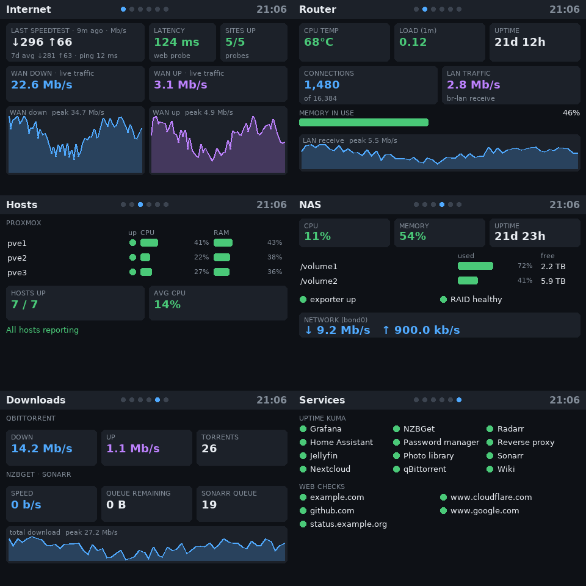
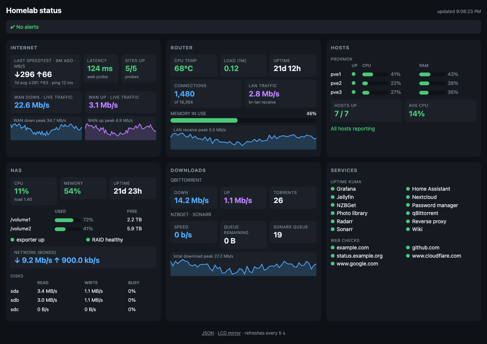

# netdisplay

[](https://github.com/rodneyshupe/netdisplay/actions/workflows/tests.yml)

A small, config-driven status dashboard for **a little LCD on a Raspberry Pi**, **a web page**, and **the command line**, all fed by PromQL queries against Prometheus, VictoriaMetrics or anything else that speaks the Prometheus HTTP API.

You describe what to show in one YAML file: stats, sparklines, bars, status lists and tables, each backed by a query. netdisplay resolves it once into a single model and draws that model three ways, so the screen, the web page and `netdisplay show --json` always agree.

| LCD (480×320 framebuffer) | Web page |
|---|---|
|  |  |

*(Both are rendered from [`examples/homelab.yaml`](examples/homelab.yaml) using the invented data in [`examples/demo-data.yaml`](examples/demo-data.yaml); see [Try it with demo data](#quick-start-try-it-on-any-computer).)*

## About this project

netdisplay is a **personal project**. It was built for one home network: a Raspberry Pi 2 with a small SPI screen that used to run the Pi-hole PADD display, repurposed to show router, DNS, NAS, Proxmox and service status from a VictoriaMetrics server. It is shared in case it is useful to someone else, not offered as a polished product.

- **Use it as a starting point.** `examples/homelab.yaml` is a typical homelab (router, Proxmox, NAS, downloads, services) built on public exporters, with every site-specific name collected in one `vars:` block. `examples/snippets/` has pages for setups that need their own metrics (Technitium DNS, an Authentik HA cluster). Expect to adjust the queries for the exporters you actually run. The config format is meant to make that easy, and the code is small enough to read in an evening.
- **Fork it and change it.** It is MIT licensed: copy it, modify it, build something different on top of it. The [Development](#development) section shows where each part lives and what a new widget type needs.
- **Expect rough edges.** It has been run on a Raspberry Pi 2 with one 480x320 fbtft screen, against VictoriaMetrics, and tested on macOS. Other screens, framebuffer drivers, Prometheus-compatible servers and exporter versions are untested.
- **No support promised.** Bug reports and ideas are welcome, but there is no commitment to answer or fix them quickly.

## Contents

- [About this project](#about-this-project)
- [What it does](#what-it-does)
- [Requirements](#requirements)
- [Quick start (try it on any computer)](#quick-start-try-it-on-any-computer)
- [Install on a Raspberry Pi with an LCD](#install-on-a-raspberry-pi-with-an-lcd)
- [The config file](#the-config-file)
  - [Top-level keys](#top-level-keys)
  - [vars](#vars) · [datasource](#datasource) · [display](#display) · [web](#web) · [alerts](#alerts)
  - [pages, rows and widgets](#pages-rows-and-widgets)
  - [Widget reference](#widget-reference): [stat](#stat) · [spark](#spark) · [bar](#bar) · [list](#list) · [table](#table) · [text](#text)
  - [Formats](#formats) · [Templates](#templates) · [Colours and thresholds](#colours-and-thresholds) · [map](#map-value--text) · [rename](#rename)
  - [How the LCD layout works](#how-the-lcd-layout-works)
  - [Writing queries](#writing-queries)
- [Examples, snippets and contrib](#examples-snippets-and-contrib)
- [Command line](#command-line)
- [Output formats (text, JSON, YAML)](#output-formats-text-json-yaml)
- [Web page and API](#web-page-and-api)
- [Operating it](#operating-it)
- [Troubleshooting](#troubleshooting)
- [Development](#development)

## What it does

- **Config-driven.** Pages are rows of widgets; every widget is a PromQL query plus a bit of presentation. No code to edit.
- **One model, three views.** The LCD, the web page and the CLI (`--json`, `--yaml`, pretty text) all render the same resolved data.
- **Rotating LCD.** Draws straight into the Linux framebuffer (`/dev/fb1`, fbtft SPI screens and similar) with Pillow, no X or desktop needed. Pages rotate on a timer, with a red alert banner on every page when something is wrong.
- **Alerts without Alertmanager.** Any PromQL expression can raise a banner message, one per matching series, with label templating.
- **Light.** Standard library plus PyYAML (and Pillow for drawing). Runs on a Raspberry Pi 2 in about 20 MB of RAM.
- **Checks your config.** `netdisplay validate` flags typos, failing or empty queries, and pages that are too tall for the LCD.

## Requirements

- Python 3.8 or newer. Tested on 3.9 (Raspberry Pi OS Bullseye and macOS) and 3.14; nothing in the code needs more than 3.8.
- **PyYAML** (config file). Debian: `apt install python3-yaml`.
- **Pillow 8.0+** and the DejaVu fonts, only for the LCD, `netdisplay png` and the web `/screen.png`. Debian: `apt install python3-pil fonts-dejavu-core`. The CLI `show`, `validate` and the web page work without it.
- A **Prometheus-compatible HTTP API** to read from: Prometheus, VictoriaMetrics, Mimir, Thanos, Grafana Cloud...
- For the LCD: a screen that shows up as a framebuffer such as `/dev/fb1` (see [below](#install-on-a-raspberry-pi-with-an-lcd)).

## Quick start (try it on any computer)

```bash
git clone <this repo> netdisplay && cd netdisplay
python3 -m venv .venv && . .venv/bin/activate
pip install pyyaml pillow

cp examples/basic.yaml netdisplay.yaml          # then edit datasource.url
python -m netdisplay validate                   # checks the file, the datasource and every query
python -m netdisplay show                       # pretty text
python -m netdisplay show --json                # or --yaml
python -m netdisplay serve --port 8080          # web page: http://localhost:8080/
python -m netdisplay png out/                   # LCD images as PNG files, no screen needed
```

**No Prometheus handy?** Run the full example on invented data instead:

```bash
python -m netdisplay --demo examples/demo-data.yaml -c examples/homelab.yaml serve --port 8080
python -m netdisplay --demo examples/demo-data.yaml -c examples/homelab.yaml png out/
```

`examples/basic.yaml` only needs node_exporter metrics. `examples/homelab.yaml` is a fuller example; see [Examples, snippets and contrib](#examples-snippets-and-contrib).

You can also `pip install .` (adds a `netdisplay` command; `pip install '.[lcd]'` pulls in Pillow).

## Install on a Raspberry Pi with an LCD

### 1. Get the screen showing up as a framebuffer

netdisplay writes RGB565 pixels to a framebuffer device, so the screen needs a kernel driver that exposes one. For common SPI TFT boards that is an fbtft overlay in `/boot/config.txt` (or `/boot/firmware/config.txt`), for example for a 3.5" 480×320 "tft35a" panel:

```
dtparam=spi=on
dtoverlay=tft35a:rotate=270
```

After a reboot check that `/dev/fb1` exists and its size and depth match:

```bash
ls -l /dev/fb*
cat /sys/class/graphics/fb1/virtual_size     # 480,320
cat /sys/class/graphics/fb1/bits_per_pixel   # 16
```

Other panels use vendor scripts (for example the `LCD-show` scripts for GoodTFT/Waveshare boards) or a different overlay; the only requirement is a 16-bit framebuffer. Set its path and size under [`display`](#display) if they differ. If the console is mapped onto the same framebuffer you will usually also want to stop a login prompt being drawn over the dashboard, for example `sudo systemctl mask getty@tty1.service`.

### 2. Install

On the Pi, from a checkout of this repository:

```bash
sudo ./install.sh --config examples/basic.yaml
```

`install.sh` will:

1. `apt install` python3-yaml, python3-pil and fonts-dejavu-core;
2. copy the package to `/opt/netdisplay` and create the `/usr/local/bin/netdisplay` command;
3. install your config as `/etc/netdisplay/config.yaml` (**never overwrites an existing one**);
4. install and start two systemd services: `netdisplay` (the LCD) and `netdisplay-web` (the web page, run as an unprivileged dynamic user allowed to bind port 80);
5. run `netdisplay validate`.

Options: `--no-lcd` (web only), `--no-web` (LCD only), `--uninstall`.

Edit `/etc/netdisplay/config.yaml`, check it, and restart:

```bash
sudoedit /etc/netdisplay/config.yaml
netdisplay validate
sudo systemctl restart netdisplay netdisplay-web
```

Logs: `journalctl -u netdisplay -u netdisplay-web -f`.

## The config file

A YAML file, found in this order: `--config FILE`, `$NETDISPLAY_CONFIG`, `./netdisplay.yaml`, `~/.config/netdisplay/config.yaml`, `/etc/netdisplay/config.yaml`.

Everything except `pages` has a default. Unknown keys on widgets are reported as warnings (typo catching); structural mistakes are errors that stop the program with a message saying where.

### Top-level keys

| Key | Default | What |
|---|---|---|
| `title` | `Network status` | Web page title and heading, CLI heading |
| `vars` | none | Names to reuse throughout the file as `${name}` |
| `datasource` | see below | Where the metrics come from |
| `display` | see below | LCD settings |
| `web` | see below | Web server settings |
| `alerts` | none | Rules that fill the red banner |
| `pages` | **required** | The dashboard itself |

### vars

Values that differ from one setup to the next (an instance label, a network device, a hostname) can be defined once and
used anywhere in the file as `${name}`, so adapting a config means editing a handful of lines:

```yaml
vars:
  router: gateway            # the `instance` label of your router's node_exporter
  wan_if: eth0

pages:
  - title: Internet
    rows:
      - {type: stat, label: WAN DOWN, format: bps,
         query: 'sum(rate(node_network_receive_bytes_total{instance="${router}",device="${wan_if}"}[1m])) * 8'}
```

`${name}` is replaced in every string of the file before it is checked (queries, labels, alert messages, regexes), values are
inserted as plain text, and a name that is not defined under `vars:` is an error that says where. `vars` do not nest, and the
`{label}` / `{value}` templates described under [Templates](#templates) use single braces with no `$`, so the two never clash.

### datasource

```yaml
datasource:
  url: http://localhost:9090      # base URL; /api/v1/query and /api/v1/query_range are appended
  timeout: 4                      # seconds per query
  headers:                        # optional, sent with every query (auth tokens, tenant ids...)
    Authorization: "Bearer abc123"
```

### display

| Key | Default | What |
|---|---|---|
| `framebuffer` | `/dev/fb1` | Device to draw on (16-bit RGB565) |
| `width`, `height` | `480`, `320` | Screen size in pixels |
| `page_seconds` | `10` | How long each page stays up |
| `refresh_seconds` | `5` | Redraw interval while a page is shown |
| `font_dir` | `/usr/share/fonts/truetype/dejavu` | Directory holding `DejaVuSans.ttf` and `DejaVuSans-Bold.ttf` (override with `$NETDISPLAY_FONT_DIR`) |

### web

| Key | Default | What |
|---|---|---|
| `port` | `80` | Listen port (`netdisplay serve --port` overrides) |
| `cache_seconds` | `5` | Results are shared between browsers for this long, so any number of viewers costs one set of queries |

### alerts

Alerts fill the **red banner** at the bottom of every LCD page and the top of the web page. Each rule is a PromQL expression; **every series it returns becomes one message**, so write the expression to return only what is wrong (a comparison filter such as `== 0` does exactly that).

```yaml
alerts:
  ignore:                              # regexes; matching messages are dropped
    - '^Test monitor'
  rules:
    - name: host down                  # message falls back to the name
      expr: 'up{job="node"} == 0'
      message: '{instance} is down'    # label values are available as {label}
    - name: disk nearly full
      expr: '1 - node_filesystem_avail_bytes{mountpoint="/"} / node_filesystem_size_bytes{mountpoint="/"} > 0.9'
      message: '{instance} disk {value:ratio} full'    # {value} is the sample value; formats work
```

Duplicates are removed. If the datasource cannot be reached the banner says `metrics server unreachable`. Rules that need metrics you don't have simply return nothing and never fire.

### pages, rows and widgets

```yaml
pages:
  - id: internet          # used in the CLI, the API and /screen.png?page=; default: derived from the title
    title: Internet       # shown in the header
    rows:                 # rows stack top to bottom
      - - {type: stat, ...}      # a row is a list of widgets side by side
        - {type: stat, ...}
      - {type: spark, ...}       # a bare widget is a row of one
```

**Page keys.** `id`, `title`, `rows`, and optionally `hide_if_empty: true`. A page with `hide_if_empty` is left out of the LCD rotation and the web page while **none** of its data widgets has any data (a `stat` whose query returns nothing, an empty `table`, and so on; `text` widgets don't count). It's how one config serves setups that lack an exporter: the page just isn't there until the metrics are. The LCD re-checks at the start of each rotation; `netdisplay show <id>` still shows a hidden page, and `validate` notes which pages are currently hidden.

**Widths.** A row is a 12-column grid. Each widget takes `w` columns; if you leave `w` out the row is split equally. So `w: 6` twice, or no `w` at all with two widgets, gives two halves; `w: 4` three times gives thirds.

**Heights (LCD only).** Each widget has a natural height (see [layout](#how-the-lcd-layout-works)); set `h:` in pixels to override. A row is as tall as its tallest widget. The web page ignores `h` and sizes itself.

**Common keys on every widget**

| Key | What |
|---|---|
| `type` | `stat`, `spark`, `bar`, `list`, `table` or `text` |
| `id` | Optional name. Makes the widget's raw value available as `pages[].values.<id>` in JSON/YAML |
| `w` | Width in 12ths of the row |
| `h` | LCD height in pixels |
| `only` | `lcd` or `web`: show the widget on only that output (the CLI shows everything). Use `only: web` for things too tall for the LCD |

### Widget reference

#### stat

A tile with a small label, a big value and an optional sub-line. The workhorse.

```yaml
- type: stat
  label: CPU TEMP
  query: 'node_thermal_zone_temp{instance="router"}'
  format: celsius
  thresholds: {warn: 75, bad: 90}     # colours the value
  sub: 2 cores
```

| Key | What |
|---|---|
| `label` | Small heading. A [template](#templates), so it can include query values |
| `query` | One PromQL expression; the **first series' value** is shown |
| `queries` | Instead of `query`: a map of names to expressions, for [templates](#templates) that combine several values. The one named `v` (or else the first) is the main value |
| `value` | [Template](#templates) for the big text. Default: the main value in `format` |
| `format` | How to format values; see [Formats](#formats). Default `num` |
| `sub` | Template for the small line at the bottom (hidden when `h` is under 52) |
| `thresholds` | Colour by value; see [Colours and thresholds](#colours-and-thresholds) |
| `color` | Fixed colour, overriding thresholds |
| `color_query` | Name of one of the `queries` to use for the colour instead of the main value |
| `map` | Turn specific values into text/colours; see [map](#map-value--text) |
| `value_label` | Show a **label value** of the first series instead of its number, e.g. `instance` to display *which host* a query matched |
| `rename` | [Regex substitutions](#rename) applied to `value_label` text |
| `empty_text`, `empty_color` | What to show when the query returns nothing (default `n/a`, dim) |

Several values in one tile:

```yaml
- type: stat
  label: 'LAST SPEEDTEST · {age:dur} ago'
  queries:
    down: 'last_over_time(speedtest_download_bits_per_second[6h])'
    up:   'last_over_time(speedtest_upload_bits_per_second[6h])'
    age:  'time() - timestamp(speedtest_download_bits_per_second)'
  value: '↓{down:mbps} ↑{up:mbps}'
```

Showing which node is the master:

```yaml
- type: stat
  label: MASTER
  query: 'keepalived_vip_holder == 1'      # returns one series: the node holding the VIP
  value_label: instance
  empty_text: NONE
  empty_color: bad
  color: good
```

#### spark

A small line chart of the last `minutes` of a query (a range query; the **first series** is drawn, so aggregate with `sum(...)` if needed).

| Key | Default | What |
|---|---|---|
| `query` | required | Expression |
| `label` | | Shown top-left with the peak value |
| `minutes` | `30` | Time window |
| `points` | `60` | Resolution |
| `format` | `num` | Format for the peak value |
| `color` | `accent` | Line colour |

```yaml
- {type: spark, h: 90, label: WAN down, format: bps, minutes: 60,
   query: 'sum(rate(node_network_receive_bytes_total{device="wan"}[1m])) * 8'}
```

#### bar

A labelled horizontal bar filled to a percentage.

| Key | Default | What |
|---|---|---|
| `query` | required | Expression giving the value |
| `scale` | `1` | Multiplier to get 0–100 (use `100` for a 0–1 ratio) |
| `label` | | Text above the bar |
| `text` | `{v:pct}` | Template for the text on the right |
| `thresholds`, `color` | | Colouring; default green |

```yaml
- type: bar
  label: MEMORY IN USE
  thresholds: {warn: 80, bad: 92}
  query: '100 * (1 - node_memory_MemAvailable_bytes / node_memory_MemTotal_bytes)'
```

#### list

A list of status dots with names. From one query (one item per series) and/or a fixed set of items.

| Key | Default | What |
|---|---|---|
| `title` | | Small heading |
| `query` | | One item per series returned |
| `name` | `{instance}` | Template for the item's name; label values are available as `{label}` |
| `items` | | Fixed items: `[{name: RAID, query: '...'}, ...]`, each with its own query |
| `ok_if` | `one` | When the dot is green: `one` (value ≥ 1), `nonzero`, `zero`. A missing value gives a grey dot |
| `text` | | Optional template shown dimly on the right, e.g. `'{value:ms}'` |
| `format` | `num` | Default format for the templates |
| `include`, `exclude` | | Regexes on the item name |
| `rename` | | [Regex substitutions](#rename) on the name |
| `sort` | `failing_first` | `failing_first`, `name` or `none` |
| `limit` | | Keep the first N after sorting |
| `cols` | `2` | Columns on the LCD (the web page flows automatically) |
| `empty_text`, `empty_color` | `none`, dim | Shown when there are no items, e.g. `All hosts reporting` in green for a "what's down" list |

```yaml
- type: list
  title: INTERNAL SERVICES
  query: 'monitor_status{monitor_type!="group"}'        # Uptime Kuma
  name: '{monitor_name}'
  exclude: '^Test'
  cols: 3
- type: list                                            # an "everything is fine" list
  query: 'up{job="node"} == 0'
  cols: 1
  empty_text: All hosts reporting
  empty_color: good
```

#### table

Rows joined from several queries on a label, with a column per query.

| Key | Default | What |
|---|---|---|
| `title` | | Small heading |
| `key` | `instance` | Label to join the columns on: one row per distinct value |
| `name` | `{<key>}` | Template for the row's name |
| `rename` | | [Regex substitutions](#rename) on the name |
| `columns` | required | List of columns, below |
| `include`, `exclude`, `sort`, `limit` | `sort: name` | As for `list`; `sort: none` keeps query order |
| `empty_text` | `no data` | Shown when there are no rows |

Column keys:

| Key | Default | What |
|---|---|---|
| `header` | | Column heading |
| `query` | required | Expression; each series is matched to a row by its `key` label. Rows with no value in a column show `n/a` or a grey dot |
| `kind` | `text` | `text`, `bar` (filled bar plus the percentage) or `dot` (green if ≥ 1, red if 0, grey if missing) |
| `format` | `num` (`pct` for bars) | Value format |
| `scale` | `1` | For `bar`: multiplier to 0–100 |
| `thresholds`, `color`, `map` | | As for `stat` |
| `width` | 26 dot, 120 bar, 74 text | LCD width in pixels. The name column takes what is left |

```yaml
- type: table
  title: PROXMOX
  key: id
  rename: [['^node/', '']]
  columns:
    - {header: up,  kind: dot, query: 'pve_up{id=~"node/.*"}'}
    - {header: CPU, kind: bar, scale: 100, thresholds: {warn: 70, bad: 90}, query: 'pve_cpu_usage_ratio{id=~"node/.*"}'}
    - {header: RAM, kind: bar, scale: 100, thresholds: {warn: 80, bad: 92},
       query: 'pve_memory_usage_bytes{id=~"node/.*"} / pve_memory_size_bytes{id=~"node/.*"}'}
```

#### text

Fixed text, handy as a section heading: `{type: text, text: QBITTORRENT, color: dim}`.

### Formats

`format` turns a number into text. Some take a number of digits after a colon: `num:2`, `pct:1`.

| Format | Input | Example output |
|---|---|---|
| `num` | number | `16,384`; fractions show 2 decimals; `num:3` forces digits |
| `int` | number | `7` |
| `bps` | bits per second | `283.0 Mb/s` |
| `Bps` | bytes per second | `1.5 kB/s` |
| `mbps` | bits per second | `296` (whole megabits, no unit) |
| `bytes` | bytes | `1.9 TB` |
| `pct` | 0–100 | `46%` |
| `ratio` | 0–1 | `50%` |
| `dur` | seconds | `1d 2h`, `3h 5m`, `9m`, `40s` |
| `ms` | milliseconds | `13 ms` |
| `celsius` | °C | `72°C` |
| `updown` | 0/1 | `up` / `DOWN` |
| `text` | anything | as is (label values always render this way) |

### Templates

Text fields marked *template* (`label`, `value`, `sub`, `name`, `text`, `message`) can contain `{name}` or `{name:format}`:

- in a **stat**, the names are the keys of `queries` (or `v` for a single `query`);
- in a **list/table**, they are the series' **label names**, plus `{value}` for the sample value (lists only);
- in an **alert rule**, label names plus `{value}`.

Without `:format` a number uses the widget's `format`; label values are always plain text. Unknown names render as empty text.

### Colours and thresholds

Colour names: `good` (green), `warn` (amber), `bad` (red), `accent` (blue), `accent2` (purple), `dim` (grey), `fg` (normal text).

```yaml
thresholds: {warn: 70, bad: 90}          # higher is worse: green below 70, amber to 90, red above
thresholds: {warn_below: 60}             # lower is worse: amber under 60
thresholds: {bad_below: 100}             # e.g. "red unless 100% of hosts are up"
```

A missing value is dim grey. `color:` overrides thresholds. Use `color_query` on a `stat` to colour by a different number than the one displayed, for example to turn the speedtest tile amber when the last run is under 60% of the 7-day average.

### map (value → text)

For states rather than quantities. Keys are the (rounded) values, plus an optional `default`:

```yaml
map:
  1: {text: healthy, color: good}
  0: {text: ISSUES,  color: bad}
  default: {text: unknown, color: warn}
```

Works on `stat` and on table columns. `text` and `color` are each optional.

### rename

`rename` is a list of `[regex, replacement]` pairs applied in order with Python's `re.sub` (so `\1` refers to a group):

```yaml
rename: [['^docker-', ''], ['\..*$', '']]          # docker-dns1.example.net -> dns1
rename: [['^/share/(.*)$', 'USB \1']]
```

### How the LCD layout works

Rows stack from just under the header. The screen has room for roughly **250 pixels** of content at 480×320 (it is `height - 30 header - 8 gap - 30 banner`). Natural heights:

| Widget | Height |
|---|---|
| `stat` | 62 (sub-line hidden under 52) |
| `spark` | 60 |
| `bar` | 34 |
| `text` | 18 |
| `list` | title 16 + 22 per line (items ÷ `cols`, rounded up); 18 when empty |
| `table` | title 16 + header 14 + 24 per row; 18 when empty |

Rows are separated by 8 px. If a page is too tall the bottom is cut off on the LCD (the web page is unaffected); `netdisplay validate` warns about it. Fix by lowering `h`, using fewer rows, `limit`, or `only: web` for the tall widgets.

### Writing queries

- Every query is a **PromQL instant query** except `spark`, which is a range query. Anything your server supports works, including recording rules.
- A `stat`, `bar` or `spark` uses the **first series returned**. Aggregate with `sum`, `max`, `avg`, `count` to get exactly one.
- To compute a ratio of two different metrics, write it in PromQL (`100 * a / b`); both sides need matching labels, or aggregate each side first.
- A counter should go through `rate(...)`. Multiply by 8 to turn bytes/s into bits/s for the `bps` format.
- `up == 0` style expressions return **only the failing series**, which is what you want for alert rules and "what's down" lists. In a stat that has no data, set `empty_text`.
- The examples stick to PromQL that works on Prometheus 2.26+ and on VictoriaMetrics. VictoriaMetrics' MetricsQL (a superset of PromQL, with functions such as `lag()`) is fine too if that is what you run.
- Instant queries only see samples from the last few minutes. For slow metrics (a speedtest every 30 minutes) wrap them: `last_over_time(metric[6h])` (Prometheus 2.26+).
- Test queries in your server's UI first, then `netdisplay validate` tells you which return nothing.

## Examples, snippets and contrib

| Path | What |
|---|---|
| [`examples/basic.yaml`](examples/basic.yaml) | The smallest useful config: needs only a Prometheus scraping node_exporter. Start here |
| [`examples/homelab.yaml`](examples/homelab.yaml) | A fuller homelab: internet and speedtest, router, Proxmox, NAS, downloads, services. Public exporters only; every site-specific name is in its `vars:` block; pages for exporters you don't run hide themselves |
| [`examples/snippets/`](examples/snippets/) | Page fragments for setups that need their own metrics: **Technitium DNS** and an **Authentik HA cluster** (which node is the master, and is everything healthy). Each file is a complete config you can `validate`, from which you copy the page |
| [`examples/demo-data.yaml`](examples/demo-data.yaml) | Invented data for `--demo`, so you can try `homelab.yaml` with no Prometheus. Also what the screenshots are rendered from |
| [`contrib/`](contrib/README.md) | [`authentik_metrics.sh`](contrib/authentik_metrics.sh): a read-only script for each Authentik node that pushes the cluster state the snippet shows to a Pushgateway |

**Demo mode** replaces the datasource with a fixture file: a list of rules, each a regex matched against a query plus the
series it should return, first match wins. Write your own to render screenshots of a config without exposing real data. The
format is described at the top of [`netdisplay/demo.py`](netdisplay/demo.py).

## Command line

```
netdisplay [-c CONFIG] [--demo FILE] <command>

  -c, --config FILE   config file (see The config file for the search path)
      --demo FILE     use canned data from a demo fixture instead of the datasource

  run              run the rotating LCD display (the default if no command is given)
  show [PAGE...]   print the data: pretty text by default
        --json | --yaml      machine-readable (mutually exclusive)
        --history            include sparkline points in --json/--yaml
        --no-color
  pages            list page ids
  png DIR          render every page to DIR/<n>_<id>.png (preview or screenshot without a screen)
  serve [--port N] run the web page and API
  validate         check config, datasource, every query and the LCD layout; exit 1 on errors
                   (also notes pages hidden by hide_if_empty)
```

`netdisplay validate` reports unknown or misspelt keys, whether the datasource answers, pages that don't fit the LCD, and queries that fail or return nothing. Queries that return nothing are warnings (some, like "what's down" lists, are meant to be empty); failing queries and an unreachable datasource exit with status 1.

## Output formats (text, JSON, YAML)

`show` prints a readable summary; `--json` and `--yaml` print the same data for scripts:

```jsonc
{
  "generated": "2026-10-16T20:34:51-0700",
  "title": "Homelab status",
  "alerts": ["pve2 down"],
  "pages": [
    {
      "id": "dns",
      "title": "DNS",
      "empty": false,                     // true when none of the page's data widgets had data
      "values": {                         // widgets that have an `id`, with their raw values
        "queries": 18634.0,               //   stat, spark, bar  -> the number (spark: the latest point)
        "blocked": 14.2,
        "resolvers": [                    //   table -> list of {name, <header>: raw value, ...}
          {"name": "dns1", "up": 1.0, "queries/h": 6983.0}
        ]                                 //   list  -> list of {name, ok, text}
      },
      "widgets": [                        // everything that is drawn, in order, with formatted text
        {"type": "stat", "id": "queries", "label": "QUERIES / HOUR", "text": "18,634", "color": "accent", "sub": "", "raw": 18634.0}
      ]
    }
  ]
}
```

Raw numbers are in base units (bits/s, bytes, seconds). Give a widget an `id` to find its value easily:

```bash
netdisplay show dns --json | jq '.pages[0].values.blocked'
netdisplay show --yaml | yq '.pages[] | select(.id=="nas") | .values.volumes'
```

## Web page and API

`netdisplay serve` (or the `netdisplay-web` service) serves, on `web.port`:

| URL | What |
|---|---|
| `/` | The dashboard: every page as a card, refreshing every 5 s; works on a phone; follows light/dark mode |
| `/api/all` | The whole resolved model as JSON, including sparkline points |
| `/api/<page id>` | One page: `{generated, alerts, page}` |
| `/api/pages` | `[{id, title}]` |
| `/screen.png?page=<id>` | The LCD image for a page (needs Pillow) |
| `/healthz` | `ok` |

Data is collected at most once per `web.cache_seconds`, however many browsers or scripts are connected.

**There is no authentication.** The page lists host names, addresses and service state, so keep it on a trusted LAN; do not port-forward it. If you want it on a public name, put it behind an authenticating reverse proxy.

## Operating it

- **Change the config:** edit `/etc/netdisplay/config.yaml`, `netdisplay validate`, then `sudo systemctl restart netdisplay netdisplay-web`. The config is read at start-up.
- **Query load:** the LCD resolves the page being shown every `refresh_seconds` (one page, in parallel). The web server resolves everything at most every `cache_seconds`. Both cost a few dozen small queries.
- **Pi 2 numbers:** the LCD loop uses roughly 20–30% of one core, mostly converting the image to RGB565; the web server idles near 0%.
- **Uninstall:** `sudo ./install.sh --uninstall` (leaves `/etc/netdisplay/config.yaml`).
- **Secrets:** both services read `/etc/netdisplay/config.yaml`, and the web service runs as an unprivileged dynamic user, so the file must be world-readable (the installer uses mode 644). If you put a token under `datasource.headers`, use one that can only read metrics.

## Troubleshooting

| Symptom | Likely cause |
|---|---|
| `config error: no config file found` | Pass `-c FILE` or set `NETDISPLAY_CONFIG` |
| `validate`: `datasource ... is not answering` | Wrong `datasource.url`, firewall, or the server needs `headers` |
| A tile shows `n/a` | Its query returned nothing; run `validate` and try the query in your server's UI. For slow metrics wrap in `last_over_time(...[6h])` |
| Banner says `metrics server unreachable` | The datasource is down or too slow (`timeout`) |
| LCD stays blank / garbled | Wrong `display.framebuffer`, `width`/`height`, or not a 16-bit framebuffer. Compare `/sys/class/graphics/fbN/{virtual_size,bits_per_pixel}` |
| A login prompt or cursor shows through | Mask `getty@tty1`; the service already disables the cursor blink |
| A tile reads `<type> widget error: ...` | That widget's config or query is broken; the message says how. The rest of the page still draws |
| Text cut off with `…` | Shorten labels, widen table column `width`s, or use fewer `cols` |
| Bottom of a page cut off on the LCD | `validate` warns; reduce `h`, rows or `limit`, or `only: web` |
| Web page OK but `/screen.png` fails | Pillow or the DejaVu fonts are missing |
| Port 80 `Permission denied` | Run it through the installed service (which grants `CAP_NET_BIND_SERVICE`), or use `--port 8080` |

## Development

```bash
python3 -m venv .venv && . .venv/bin/activate
pip install pyyaml pillow pytest
pytest                                  # unit tests run against a fake datasource, no network needed
python -m netdisplay -c examples/basic.yaml validate
python -m netdisplay --demo examples/demo-data.yaml -c examples/homelab.yaml show     # no server needed
```

Layout of the code:

| File | Role |
|---|---|
| `netdisplay/config.py` | Load, default and validate the YAML |
| `netdisplay/metrics.py` | Prometheus-compatible HTTP client |
| `netdisplay/model.py` | Resolve widgets and alerts into plain data (**start here to add a widget type**) |
| `netdisplay/fmt.py` | Formats, templates, thresholds |
| `netdisplay/demo.py` | Canned-data datasource behind `--demo` |
| `netdisplay/lcd.py` | Layout engine, Pillow drawing, RGB565 framebuffer output |
| `netdisplay/web.py`, `web/index.html` | HTTP server and the single-page front end |
| `netdisplay/output.py` | Pretty text, JSON, YAML |
| `netdisplay/cli.py` | Commands |
| `examples/`, `contrib/` | Example configs, snippets, demo data, optional helper scripts |

A new widget type needs: an allowed-keys entry in `config.WIDGETS`, a `resolve_*` function in `model.py`, a `draw_*` function and a height in `lcd.py`, and a renderer in `web/index.html`.

## License

MIT, see [LICENSE](LICENSE).
